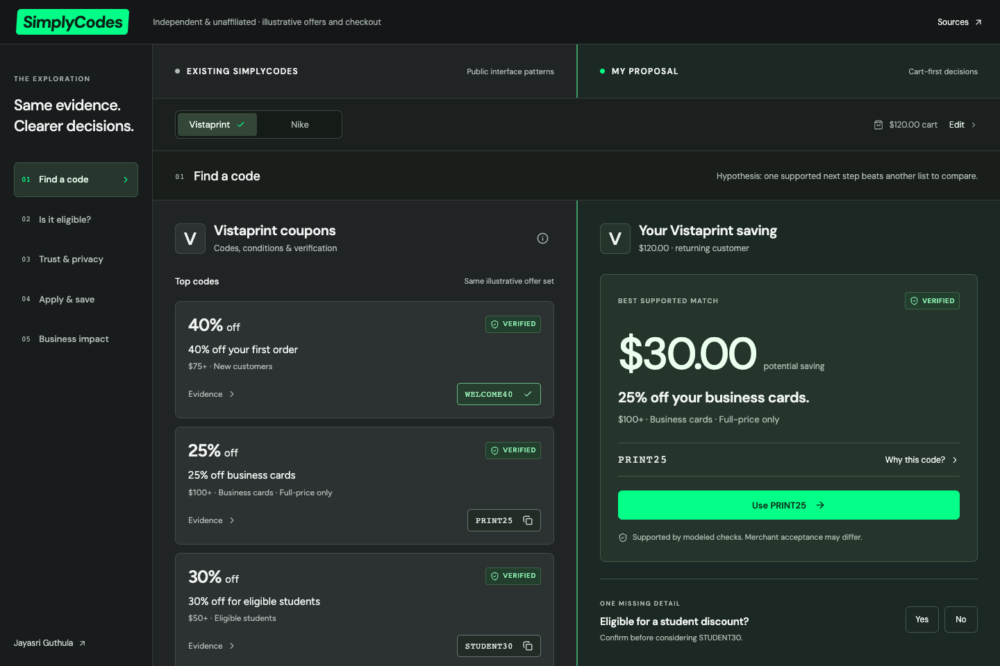
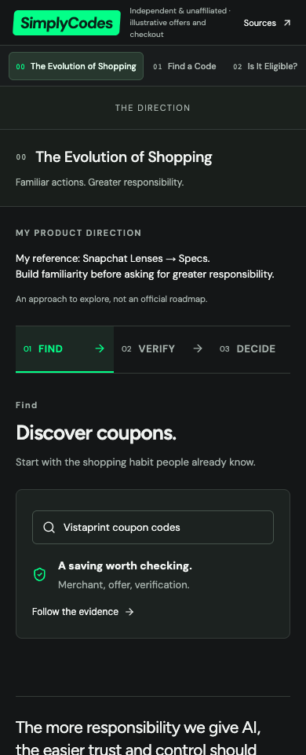
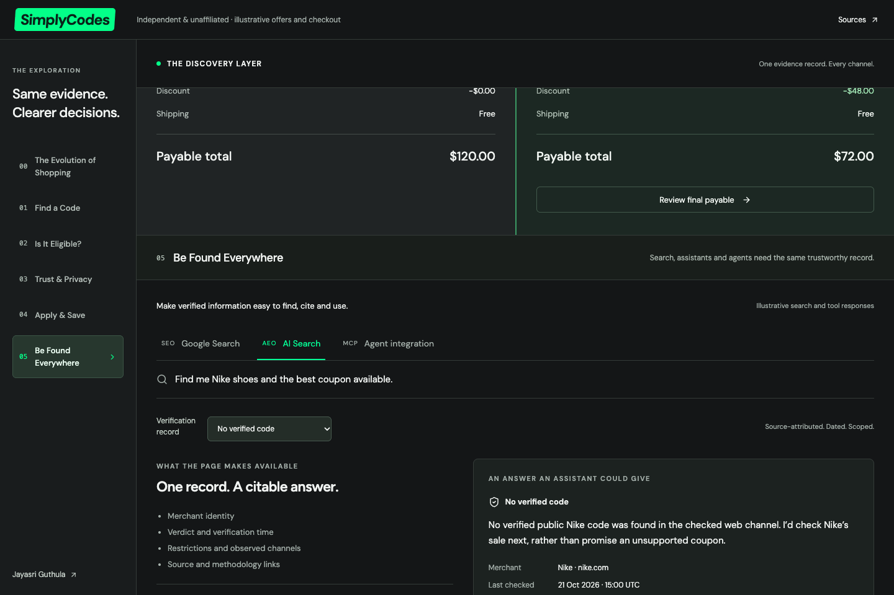
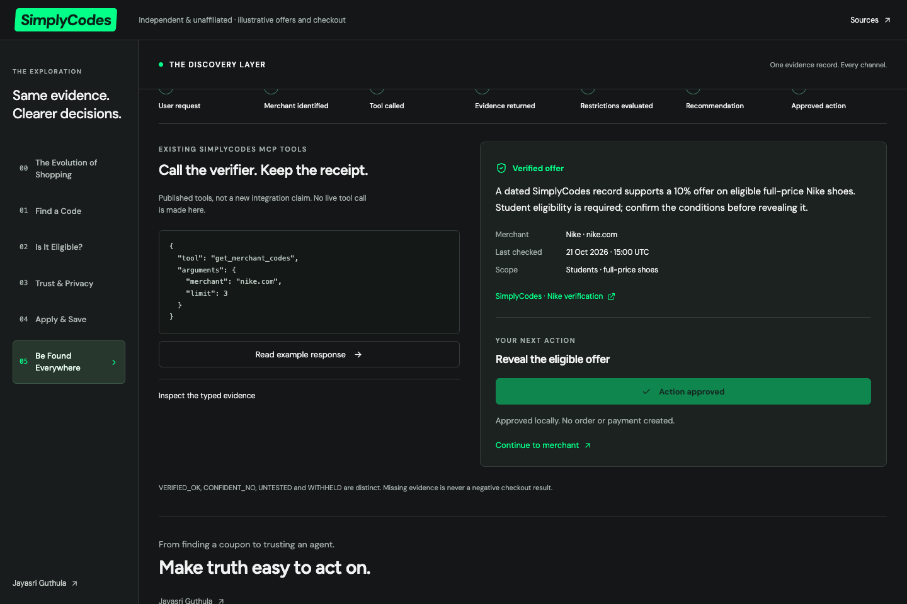
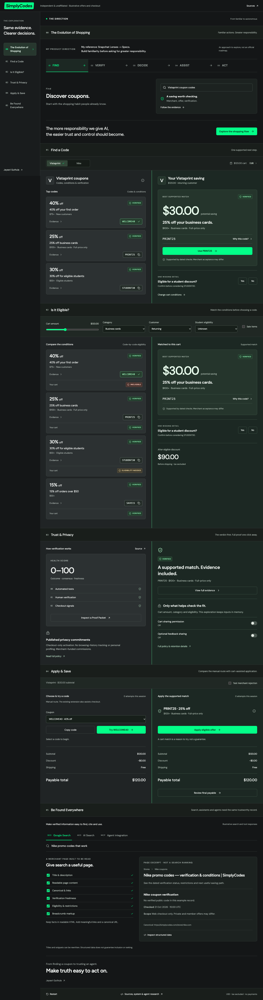

# Evolution and discovery: visual review

Reviewed six chapters at 1440, 1280, 768 and 390px using real Chromium screenshots. Existing and Proposal retain the dark scoped palettes and two-column comparison; desktop retains its navigation rail. The new opening and finale span the product columns. At 768px compact navigation preserves both panes; phones retain a view switch for chapters 01–04 and a contextual label for 00/05.

All five evolution stages and the three discovery channels were exercised. Full-page, individual chapter, evidence drawer, AI-answer and approved-agent captures are generated in ignored `test-results/`. Selected captures are retained below.

## Findings and fixes

- Reindexed navigation, chapter targets and cart/checkout jumps from 00 to 05.
- Removed calculator UI, state and CSS while preserving the pure shared contribution function.
- Preserved the existing typography, contrast, green actions, equal panes, evidence dialogs and checkout alignment.
- Added horizontal evolution tabs with automatic rail scrolling, keyboard traversal and compact examples. The approval example can be undone and resets when the cart changes.
- Used actual breadcrumb properties and visible page content instead of a fake Google ranking screenshot. AI answers cite a dated source and preserve no-code outcomes.
- Kept the MCP evidence inspector optional, the four verdicts separate, and eligibility ahead of approval. No paid-tier code is invented or exposed.
- Fixed chapter tracking in tall, dynamically changing sections; the active navigation now remains correct within the agent experience.
- Fixed a native phone focus-scroll jump by making the comparison switch fixed-position with reserved layout space.
- Checked all required widths for clipped text and document overflow. Automated accessibility found no violations in the tested states.

## Previous and current opening

## AI search and agent interaction

## All six chapters

